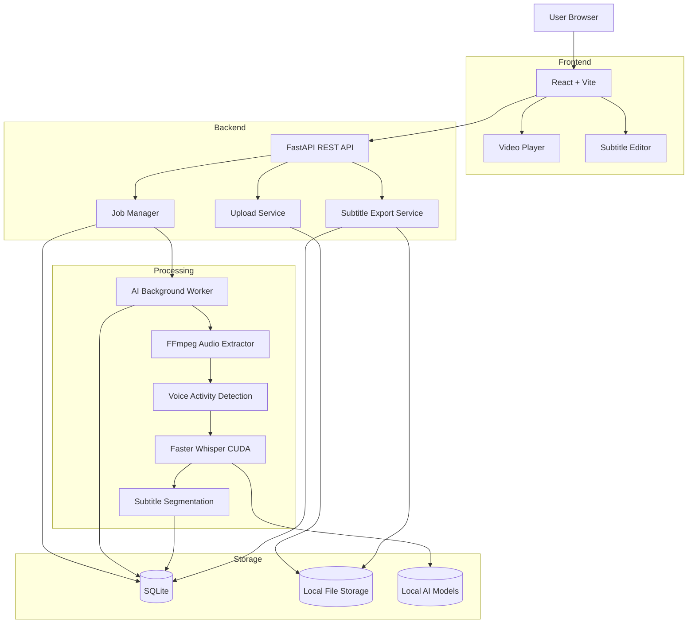

# Local AI Video-to-SRT Studio
## System Design & Development Specification

**Version:** 1.0  
**Project Type:** Local AI Speech-to-Text Web Application  
**Processing:** Fully Local / Offline Inference  
**Primary Language:** Multilingual Original Transcription  
**Speaker Diarization:** Disabled  
**Target GPU:** NVIDIA RTX 4070 Super 12GB

---

# 1. Project Overview

Develop a web application that converts video speech into subtitle files (.srt) using local AI models.

The system must:
- Accept video files.
- Extract audio using FFmpeg.
- Transcribe speech using Faster-Whisper.
- Detect spoken language automatically.
- Generate accurate speech timestamps.
- Generate SRT subtitles in the original spoken language.
- Support manual subtitle editing.
- Preview subtitles synchronized with the original video.
- Export SRT, VTT, TXT and JSON.
- Process large video files using background workers.
- Run entirely on local hardware without external AI APIs.

## 1.1 Non-Goals

The first version must NOT implement:
- Translation.
- Voice cloning.
- Text-to-Speech.
- Speaker Diarization.
- Cloud transcription.
- Automatic subtitle burning into video.
- AI rewriting or summarization.

---

# 2. System Architecture

## 2.1 Architecture Diagram



## 2.2 Components

| Component | Technology | Responsibility |
|---|---|---|
| Frontend | React + Vite | Web UI |
| UI Language | TypeScript | Type safety |
| Backend | FastAPI | REST API |
| ORM | SQLAlchemy | Database access |
| Migration | Alembic | Schema migration |
| Database | SQLite | Metadata and subtitles |
| AI Engine | Faster-Whisper | Speech recognition |
| Model Runtime | CTranslate2 | AI inference |
| Audio Processing | FFmpeg | Audio extraction |
| VAD | Silero VAD | Speech detection |
| Worker | Python | Background processing |
| Communication | REST + Polling | Job status |
| Video Player | HTML5 Video | Preview |
| Styling | Tailwind CSS | UI styling |

For the first version, use a database-backed job queue and a separate Python worker process. Redis and RabbitMQ are not required initially.

---

# 3. AI Model Selection

## 3.1 Primary Model

Use Faster-Whisper.

Repository:
https://github.com/SYSTRAN/faster-whisper

Models:

| Profile | Model | Precision |
|---|---|---|
| Quality | large-v3 | float16 |
| Balanced | large-v3-turbo | float16 |
| Low VRAM | large-v3 | int8_float16 |

Default model:
`large-v3`

The RTX 4070 Super has sufficient VRAM for the proposed single-model inference configuration. Monitor VRAM usage and avoid excessive batch sizes.

## 3.2 Default Configuration

```python
MODEL_NAME = "large-v3"

DEVICE = "cuda"
COMPUTE_TYPE = "float16"

BEAM_SIZE = 5

VAD_FILTER = True

WORD_TIMESTAMPS = True

CONDITION_ON_PREVIOUS_TEXT = True

TASK = "transcribe"
```

Important:
- Use `transcribe`, never `translate`.
- Allow language auto-detection.
- Allow manual language selection.
- Store detected language and probability.
- Do not silently convert original language into English or Thai.

## 3.3 Model Manager

Implement a ModelManager service.

Responsibilities:
- Load models.
- Cache loaded model.
- Prevent multiple model instances from consuming VRAM.
- Expose model availability.
- Expose GPU information.
- Support model selection per job.
- Allow graceful model unloading.

Do not reload the model for every subtitle job.

## 3.4 Quality Configuration

Provide configurable settings:

```json
{
  "model": "large-v3",
  "language": null,
  "task": "transcribe",
  "beam_size": 5,
  "best_of": 5,
  "vad_filter": true,
  "word_timestamps": true,
  "condition_on_previous_text": true,
  "temperature": 0,
  "initial_prompt": null
}
```

Validate parameters supported by the installed Faster-Whisper version. Do not pass unsupported parameters directly.

---

# 4. Video and Audio Processing

## 4.1 Supported Input

- MP4
- MKV
- AVI
- MOV
- WebM
- M4V

Use FFprobe to validate the file and inspect:
- Duration
- Resolution
- Video codec
- Audio codec
- Audio streams
- Sample rate
- Channel count

Reject files without an audio stream.

## 4.2 Audio Extraction

Use FFmpeg.

Convert the selected audio stream into:

- Format: WAV
- Codec: PCM signed 16-bit little-endian
- Sample rate: 16000 Hz
- Channels: Mono

Example:

```bash
ffmpeg -y -i input.mp4 \
  -map 0:a:0 \
  -vn \
  -ac 1 \
  -ar 16000 \
  -c:a pcm_s16le \
  output.wav
```

Important:
- Do not modify the original video.
- Keep the original file.
- Handle multiple audio streams.
- Allow the user to select an audio track.
- Capture FFmpeg errors.
- Support cancellation.

Do not load an entire large audio file into RAM unnecessarily.

---

# 5. Transcription Engine

Create an abstraction layer:

```python
class TranscriptionEngine:

    def load_model(self, model_name: str):
        pass

    def transcribe(
        self,
        audio_path: str,
        language: str | None,
        options: dict
    ):
        pass

    def unload_model(self):
        pass
```

Implementation:
`FasterWhisperEngine`

Example:

```python
from faster_whisper import WhisperModel

model = WhisperModel(
    "large-v3",
    device="cuda",
    compute_type="float16"
)

segments, info = model.transcribe(
    "audio.wav",
    task="transcribe",
    beam_size=5,
    language=None,
    word_timestamps=True,
    vad_filter=True,
    condition_on_previous_text=True,
    temperature=0
)

segments = list(segments)

print(info.language)
print(info.language_probability)

for segment in segments:
    print(segment.start)
    print(segment.end)
    print(segment.text)

    if segment.words:
        for word in segment.words:
            print(word.start, word.end, word.word)
```

The worker must fully consume the segment generator before marking the job complete.

## 5.1 Transcription Result

Store:

```json
{
  "language": "th",
  "language_probability": 0.98,
  "duration": 120.5,
  "segments": [
    {
      "start": 1.2,
      "end": 3.5,
      "text": "สวัสดีครับ วันนี้เราจะมาเรียนรู้เรื่อง AI",
      "words": []
    }
  ]
}
```

Preserve raw transcription output separately from formatted subtitle output.

---

# 6. Subtitle Processing Engine

Create a dedicated SubtitleProcessor.

Do not generate SRT directly from raw Whisper segments.

Processing stages:

1. Normalize text.
2. Remove unwanted empty segments.
3. Validate timestamps.
4. Merge or split subtitle segments when appropriate.
5. Preserve punctuation.
6. Avoid cutting words.
7. Apply minimum and maximum display duration.
8. Prevent subtitle overlaps.
9. Generate sequential subtitle indices.

## 6.1 Subtitle Rules

Default configuration:

```json
{
  "max_lines": 2,
  "max_chars_per_line": 42,
  "min_duration": 0.8,
  "max_duration": 7.0,
  "max_reading_speed": 20,
  "gap_between_subtitles": 0.05,
  "preserve_sentence_boundaries": true
}
```

These values are defaults, not absolute rules.

For Thai:
- Do not split text at arbitrary character positions.
- Use Thai word-boundary detection when splitting is necessary.
- Preserve natural sentence boundaries.
- Avoid breaking names and technical terminology.

For English:
- Prefer splitting at spaces and punctuation.
- Avoid splitting words.
- Prefer sentence boundaries.

Important:
Do not stretch timestamps excessively just to satisfy reading-speed settings.

Do not fabricate timing for words without valid word timestamps.

If word-level timing is unavailable, use segment-level timestamps.

## 6.2 Subtitle Data Model

```json
{
  "index": 1,
  "start_ms": 1200,
  "end_ms": 3500,
  "text": "Hello everyone.",
  "original_text": "Hello everyone.",
  "edited": false
}
```

Use integer milliseconds internally.

Convert to SRT timestamp format only during export.

## 6.3 SRT Formatter

Example:

```python
def format_timestamp(ms: int) -> str:
    hours = ms // 3600000
    minutes = (ms % 3600000) // 60000
    seconds = (ms % 60000) // 1000
    milliseconds = ms % 1000

    return (
        f"{hours:02}:"
        f"{minutes:02}:"
        f"{seconds:02},"
        f"{milliseconds:03}"
    )
```

Output:

```srt
1
00:00:01,200 --> 00:00:03,500
Hello everyone.

2
00:00:03,600 --> 00:00:06,200
Welcome to our tutorial.
```

Use UTF-8 encoding, preferably with UTF-8 BOM as an optional export setting for compatibility with older Windows applications.

---

# 7. Database Design

Use SQLite with SQLAlchemy 2.x and Alembic.

Database:
`data/database/app.db`

## 7.1 Table: projects

| Column | Type | Description |
|---|---|---|
| id | UUID | Primary key |
| name | VARCHAR(255) | Project name |
| description | TEXT | Description |
| created_at | DATETIME | Creation date |
| updated_at | DATETIME | Last update |

## 7.2 Table: media_files

| Column | Type | Description |
|---|---|---|
| id | UUID | Primary key |
| project_id | UUID | Project reference |
| original_name | VARCHAR(500) | Original filename |
| stored_name | VARCHAR(255) | Internal filename |
| file_path | TEXT | Storage path |
| file_size | BIGINT | File size |
| duration_ms | BIGINT | Video duration |
| video_codec | VARCHAR(100) | Video codec |
| audio_codec | VARCHAR(100) | Audio codec |
| width | INTEGER | Video width |
| height | INTEGER | Video height |
| audio_stream_index | INTEGER | Selected audio stream |
| created_at | DATETIME | Creation date |

## 7.3 Table: transcription_jobs

| Column | Type | Description |
|---|---|---|
| id | UUID | Primary key |
| media_id | UUID | Media reference |
| status | VARCHAR(30) | Job status |
| model_name | VARCHAR(100) | AI model |
| language | VARCHAR(20) | Selected language |
| detected_language | VARCHAR(20) | Detected language |
| language_probability | FLOAT | Detection confidence |
| progress | FLOAT | Percentage |
| current_stage | VARCHAR(100) | Current operation |
| error_message | TEXT | Error details |
| started_at | DATETIME | Start time |
| completed_at | DATETIME | Completion time |
| created_at | DATETIME | Creation time |

Job statuses:

- queued
- validating
- extracting_audio
- transcribing
- processing_subtitles
- completed
- failed
- cancelling
- cancelled

## 7.4 Table: transcription_segments

| Column | Type | Description |
|---|---|---|
| id | UUID | Primary key |
| job_id | UUID | Job reference |
| segment_index | INTEGER | Original index |
| start_ms | BIGINT | Start timestamp |
| end_ms | BIGINT | End timestamp |
| original_text | TEXT | AI transcript |
| confidence | FLOAT | Optional confidence |
| raw_data | JSON | Raw segment information |

## 7.5 Table: subtitles

| Column | Type | Description |
|---|---|---|
| id | UUID | Primary key |
| job_id | UUID | Job reference |
| subtitle_index | INTEGER | Subtitle order |
| start_ms | BIGINT | Start timestamp |
| end_ms | BIGINT | End timestamp |
| text | TEXT | Editable subtitle |
| original_text | TEXT | Original AI text |
| is_edited | BOOLEAN | Edited status |
| updated_at | DATETIME | Update time |

## 7.6 Table: transcription_settings

| Column | Type | Description |
|---|---|---|
| id | UUID | Primary key |
| job_id | UUID | Job reference |
| settings_json | JSON | Configuration |
| created_at | DATETIME | Creation time |

## 7.7 Database Requirements

- Use foreign keys.
- Add indexes to job_id, media_id and status.
- Use transactions when saving subtitles.
- Enable SQLite WAL mode.
- Use database migrations.
- Never store binary video or audio inside SQLite.
- Use cascading deletion carefully.

---

# 8. Local File Storage

Directory:

```text
storage/
├── uploads/
│   └── {media_id}/
│       └── original.mp4
│
├── audio/
│   └── {job_id}/
│       └── extracted.wav
│
├── transcripts/
│   └── {job_id}/
│       └── transcript.json
│
├── subtitles/
│   └── {job_id}/
│       ├── output.srt
│       ├── output.vtt
│       └── output.txt
│
└── temp/
```

AI models:

```text
models/
├── faster-whisper/
│   ├── large-v3/
│   └── large-v3-turbo/
└── vad/
```

Requirements:
- Use generated UUIDs for storage paths.
- Never use the original filename as a filesystem path.
- Restrict upload file types.
- Validate file contents using FFprobe.
- Keep temporary files separate.
- Support automatic cleanup.
- Make retention configurable.
- Never delete source video without user confirmation.

---

# 9. Background Worker Architecture

The AI process must not execute inside a normal HTTP request.

Use two separate processes:

1. FastAPI API Server
2. Python AI Worker

For MVP, implement a SQLite-backed job queue.

Worker polling:

```text
1. Find oldest queued job.
2. Atomically claim job.
3. Set status = validating.
4. Validate media.
5. Extract audio.
6. Set status = transcribing.
7. Run Faster-Whisper.
8. Save raw transcription.
9. Process subtitles.
10. Save subtitle records.
11. Generate initial SRT.
12. Set status = completed.
```

Important:
- Only one worker should claim a job at a time.
- Only one GPU transcription job should run at once.
- Use a database transaction to claim jobs.
- Implement job cancellation.
- Implement recovery of interrupted jobs.
- Implement worker heartbeat.
- Do not leave jobs permanently stuck in processing state.

Use a single GPU worker initially. Add parallel workers only after benchmarking.

---

# 10. REST API Design

Base URL:

`http://localhost:8000/api/v1`

## 10.1 Health

### GET /health

Response:

```json
{
  "status": "ok",
  "database": "connected",
  "worker": "online",
  "gpu": "NVIDIA RTX 4070 SUPER"
}
```

## 10.2 System Information

### GET /system/info

Return:
- CPU
- RAM
- GPU
- GPU VRAM
- CUDA availability
- Installed FFmpeg version
- Installed model list
- Worker status

## 10.3 Projects

### POST /projects

Create project.

### GET /projects

List projects.

### GET /projects/{project_id}

Get project detail.

### DELETE /projects/{project_id}

Delete project and associated data according to retention rules.

## 10.4 Media Upload

### POST /media/upload

Content-Type: multipart/form-data

Fields:
- file
- project_id
- audio_stream_index

Response:

```json
{
  "media_id": "uuid",
  "filename": "video.mp4",
  "duration_ms": 120000,
  "status": "uploaded"
}
```

Support large uploads through chunked or resumable upload in a later phase.

## 10.5 Create Transcription

### POST /jobs

Request:

```json
{
  "media_id": "uuid",
  "model": "large-v3",
  "language": null,
  "settings": {
    "beam_size": 5,
    "word_timestamps": true,
    "vad_filter": true
  }
}
```

Response:

```json
{
  "job_id": "uuid",
  "status": "queued"
}
```

## 10.6 Job Status

### GET /jobs/{job_id}

Response:

```json
{
  "job_id": "uuid",
  "status": "transcribing",
  "progress": 55,
  "current_stage": "Transcribing audio",
  "detected_language": "en"
}
```

### GET /jobs

List jobs with pagination and filters.

### POST /jobs/{job_id}/cancel

Cancel job.

### POST /jobs/{job_id}/retry

Retry failed job.

## 10.7 Subtitle APIs

### GET /jobs/{job_id}/subtitles

Get all subtitle segments.

### PUT /jobs/{job_id}/subtitles/{subtitle_id}

Update one subtitle.

Request:

```json
{
  "start_ms": 1200,
  "end_ms": 3500,
  "text": "Hello everyone."
}
```

### POST /jobs/{job_id}/subtitles/bulk-update

Save multiple subtitle changes.

### POST /jobs/{job_id}/subtitles/reprocess

Regenerate subtitle segmentation from the saved raw transcription.

This must not trigger another AI transcription.

## 10.8 Export

### GET /jobs/{job_id}/export/srt

### GET /jobs/{job_id}/export/vtt

### GET /jobs/{job_id}/export/txt

### GET /jobs/{job_id}/export/json

Return downloadable files.

---

# 11. Frontend UI Design

Use React + Vite + TypeScript.

Suggested libraries:
- Tailwind CSS
- shadcn/ui
- TanStack Query
- React Router
- Zustand
- Lucide Icons

## 11.1 Dashboard

Display:
- Total projects
- Total videos
- Completed jobs
- Processing jobs
- Failed jobs
- Recent activity

Actions:
- New Project
- Upload Video
- Open Project

## 11.2 Upload Page

Features:
- Drag and drop.
- File browser.
- Upload progress.
- Video metadata preview.
- Audio stream selection.
- File validation.
- Multiple file upload.

## 11.3 Transcription Settings

Settings:

```text
Model:
  - large-v3
  - large-v3-turbo

Language:
  - Auto Detect
  - Thai
  - English
  - Japanese
  - Chinese
  - Other supported languages

Quality:
  - High
  - Balanced
  - Fast

Advanced:
  - Beam Size
  - VAD
  - Word Timestamps
  - Initial Prompt
```

No translation options.

No speaker identification options in V1.

## 11.4 Processing Page

Display:
- Video filename
- AI model
- Detected language
- Current processing stage
- Progress bar
- Elapsed time
- GPU usage
- Cancel button

Use polling every 1–2 seconds.

Do not rely on progress values from the model if they are unavailable. Report stage-level progress honestly.

## 11.5 Subtitle Editor

This is the most important UI.

Layout:

```text
+------------------------------------------------------+
| Video-to-SRT Studio                  Export SRT       |
+-------------------------+----------------------------+
|                         | Subtitle Editor            |
|                         |                            |
|      VIDEO PLAYER       | 00:00:01.200                |
|                         | Hello everyone.             |
|                         |                            |
|                         | 00:00:03.500                |
|                         | Welcome to this video.      |
|                         |                            |
+-------------------------+----------------------------+
| Timeline                |                            |
| 00:00:00 ----------- 10:00:00                       |
+------------------------------------------------------+
```

Features:
- Video playback.
- Subtitle synchronization.
- Click subtitle to seek video.
- Edit subtitle text.
- Edit start/end timestamp.
- Add subtitle.
- Delete subtitle.
- Split subtitle.
- Merge subtitle.
- Keyboard shortcuts.
- Auto-save.
- Undo/Redo.
- Search and replace.
- Export SRT.

Keyboard shortcuts:

| Shortcut | Action |
|---|---|
| Space | Play/Pause |
| Ctrl+S | Save |
| Delete | Delete selected subtitle |
| Arrow Up | Previous subtitle |
| Arrow Down | Next subtitle |
| Ctrl+Z | Undo |
| Ctrl+Y | Redo |

When editing a subtitle, update the preview in real time.

## 11.6 Subtitle Quality Checks

Display warnings for:
- Overlapping subtitles.
- End time earlier than start time.
- Empty subtitle text.
- Very short display duration.
- Excessively long lines.
- Missing subtitle indices.
- Invalid timestamps.

Allow users to fix warnings manually.

---

# 12. Export Engine

Implement independent exporters:

```text
SubtitleExporter
├── SRTExporter
├── VTTExporter
├── TXTExporter
└── JSONExporter
```

SRT requirements:
- Sequential numbering.
- HH:MM:SS,mmm timestamps.
- UTF-8 output.
- CRLF line endings for Windows compatibility.
- Blank line between entries.
- No invalid timestamps.
- Preserve original text.

Example:

```srt
1
00:00:01,200 --> 00:00:03,500
Hello everyone.

2
00:00:03,600 --> 00:00:06,200
Welcome to this tutorial.
```

---

# 13. Project Folder Structure

```text
video-to-srt/
│
├── frontend/
│   ├── src/
│   │   ├── api/
│   │   ├── components/
│   │   ├── features/
│   │   │   ├── dashboard/
│   │   │   ├── projects/
│   │   │   ├── uploads/
│   │   │   ├── transcription/
│   │   │   └── subtitle-editor/
│   │   ├── hooks/
│   │   ├── layouts/
│   │   ├── pages/
│   │   ├── stores/
│   │   ├── types/
│   │   └── utils/
│   ├── package.json
│   └── vite.config.ts
│
├── backend/
│   ├── app/
│   │   ├── api/
│   │   │   └── v1/
│   │   ├── core/
│   │   ├── database/
│   │   ├── models/
│   │   ├── schemas/
│   │   ├── repositories/
│   │   ├── services/
│   │   │   ├── media/
│   │   │   ├── transcription/
│   │   │   ├── subtitle/
│   │   │   └── export/
│   │   ├── workers/
│   │   └── main.py
│   │
│   ├── migrations/
│   ├── tests/
│   └── requirements.txt
│
├── scripts/
│   ├── install_ffmpeg.ps1
│   ├── download_models.py
│   ├── check_gpu.py
│   └── start_local.ps1
│
├── storage/
├── models/
├── data/
├── logs/
│
├── docs/
│   ├── ARCHITECTURE.md
│   ├── API.md
│   ├── DATABASE.md
│   ├── AI_MODELS.md
│   └── DEVELOPMENT.md
│
├── .env.example
├── .gitignore
├── docker-compose.yml
├── README.md
└── CLAUDE.md
```

---

# 14. Environment Configuration

Create `.env.example`:

```env
APP_NAME=VideoToSRT
APP_ENV=development
APP_HOST=127.0.0.1
APP_PORT=8000

DATABASE_URL=sqlite:///./data/database/app.db

STORAGE_PATH=./storage
MODEL_PATH=./models

WHISPER_MODEL=large-v3
WHISPER_DEVICE=cuda
WHISPER_COMPUTE_TYPE=float16

WORKER_POLL_INTERVAL=2
MAX_GPU_WORKERS=1

MAX_UPLOAD_SIZE_GB=20

ENABLE_VAD=true
ENABLE_WORD_TIMESTAMPS=true

LOG_LEVEL=INFO
```

Do not commit `.env` or user video files into Git.

---

# 15. Docker and Windows Deployment

Primary deployment target: Windows 11 local machine.

Because NVIDIA CUDA support for containers on Windows requires an appropriate WSL2 and NVIDIA configuration, provide two deployment methods:

1. Native Windows installation (recommended for initial development).
2. Docker/WSL2 deployment (optional).

Native installation:

```text
Windows 11
  |
  +-- Python Virtual Environment
  |     |
  |     +-- FastAPI
  |     +-- Faster-Whisper
  |     +-- AI Worker
  |
  +-- Node.js
  |     |
  |     +-- React Frontend
  |
  +-- FFmpeg
  |
  +-- SQLite
  |
  +-- NVIDIA CUDA Runtime
```

Provide PowerShell scripts:

- install.ps1
- start.ps1
- stop.ps1
- check_environment.ps1

Docker Compose must separate:
- frontend
- api
- worker

Ensure that the worker has the correct NVIDIA GPU access when running in Docker.

---

# 16. Error Handling

Handle:

- Unsupported video format.
- Corrupted video.
- No audio stream.
- FFmpeg not installed.
- CUDA unavailable.
- GPU out of memory.
- Model download failure.
- Model loading failure.
- Transcription failure.
- Disk full.
- Database unavailable.
- Worker unexpectedly terminated.
- User cancels processing.

Errors must be saved in logs and job records.

Do not expose internal filesystem paths or stack traces to normal frontend users.

---

# 17. Security and Reliability

Even though the system is local, implement basic security.

- Bind to localhost by default.
- Restrict CORS.
- Validate uploads.
- Sanitize filenames.
- Prevent path traversal.
- Set upload size limits.
- Use generated storage identifiers.
- Validate media using FFprobe.
- Do not execute user-supplied FFmpeg commands.
- Use subprocess argument arrays, not shell string concatenation.
- Set subprocess timeouts.
- Prevent simultaneous claims of one job.
- Do not allow deletion of files while they are being processed.

If deployed on a LAN, add authentication and access controls before exposing it to other devices.

---

# 18. Testing Strategy

## 18.1 Unit Tests

Test:
- SRT timestamp formatter.
- Subtitle segmentation.
- Timestamp validation.
- Text normalization.
- Thai text segmentation.
- English text segmentation.
- Subtitle overlap detection.
- Export formatting.

## 18.2 Integration Tests

Test:
- Video upload.
- FFprobe metadata extraction.
- FFmpeg audio extraction.
- Database persistence.
- Worker job lifecycle.
- Faster-Whisper inference.
- Subtitle editing.
- Export files.

## 18.3 Quality Benchmark

Create a test dataset containing:
- Thai speech.
- English speech.
- Japanese speech.
- Mixed-language speech.
- Background music.
- Noisy speech.
- Multiple speakers (without speaker labeling).
- Long-form video.

For each sample:
1. Prepare a human-corrected reference transcript.
2. Run large-v3.
3. Run large-v3-turbo.
4. Compare transcription errors.
5. Compare timestamp alignment.
6. Record processing time.
7. Record peak VRAM and RAM.

Metrics:
- WER for suitable languages.
- CER for languages such as Thai.
- Timestamp error in milliseconds.
- Real-time factor (processing time / media duration).
- Manual correction rate.

Do not assume a model is more accurate for Thai simply because it is larger. Evaluate with representative Thai samples.

---

# 19. Development Roadmap

## Phase 1: Environment and AI Engine

- Create repository.
- Setup Python environment.
- Install FFmpeg.
- Configure CUDA.
- Download Faster-Whisper models.
- Implement ModelManager.
- Implement video-to-audio extraction.
- Implement basic transcription.
- Export basic SRT.

Deliverable: Working CLI video-to-SRT pipeline.

## Phase 2: Backend

- Setup FastAPI.
- Setup SQLAlchemy.
- Create database schema.
- Implement media upload.
- Implement job management.
- Implement worker process.
- Implement job status API.
- Implement subtitle APIs.
- Implement export APIs.

Deliverable: Complete backend.

## Phase 3: Frontend

- Setup React + Vite.
- Create dashboard.
- Create project management.
- Create upload interface.
- Create transcription settings.
- Create processing screen.
- Implement video player.

Deliverable: Complete web application interface.

## Phase 4: Subtitle Editor

- Subtitle list.
- Inline editing.
- Timestamp editing.
- Video synchronization.
- Split and merge.
- Undo/Redo.
- Auto-save.
- Export.

Deliverable: Usable Subtitle Editor.

## Phase 5: Quality and Reliability

- Improve Thai segmentation.
- Optimize VAD.
- Benchmark model settings.
- Improve timestamp alignment.
- Handle long videos.
- Implement job recovery.
- Add logging and error reporting.
- Add automatic cleanup.

Deliverable: Production-ready local application.

---

# 20. Claude Code Development Instructions

Claude Code must follow these rules.

## General Rules

1. Read this document completely before coding.
2. Build the system incrementally.
3. Do not generate the entire application in one unverified step.
4. Use clean architecture and dependency injection where useful.
5. Separate API, services, repositories and workers.
6. Use type hints in Python.
7. Use Pydantic schemas.
8. Use TypeScript strict mode.
9. Use database migrations.
10. Add automated tests.
11. Never hardcode absolute user-specific paths.
12. Never call external AI APIs.
13. Never use cloud transcription.
14. Preserve original video files.
15. Keep transcription and subtitle formatting separate.

## AI Requirements

- Use Faster-Whisper as the primary engine.
- Use CUDA when available.
- Support large-v3 and large-v3-turbo.
- Use original-language transcription.
- Do not translate.
- Do not implement speaker diarization.
- Support word-level timestamps.
- Support VAD.
- Cache loaded model.
- Limit GPU concurrency to one worker initially.

## UI Requirements

- Modern professional interface.
- Responsive desktop-first design.
- Dark and light themes.
- Video preview.
- Subtitle editing.
- Timeline synchronization.
- Processing progress.
- Error notifications.
- Downloadable subtitle files.

## Coding Workflow

For each phase:

1. Explain implementation plan.
2. Create required files.
3. Implement code.
4. Run linting and type checks.
5. Run unit tests.
6. Run integration tests where applicable.
7. Fix errors.
8. Update documentation.
9. Report completed functionality.
10. Wait for approval before moving to the next major phase.

Do not mark a phase complete if its acceptance tests fail.

---

# 21. Initial Acceptance Criteria

The application is considered MVP-complete when:

- User can upload an MP4 file.
- System can inspect video and audio metadata.
- System can extract audio.
- System can use RTX 4070 Super for inference.
- System can detect spoken language.
- System can transcribe original speech.
- System can create timestamps.
- System can generate a valid SRT file.
- User can preview video and subtitles.
- User can edit subtitle text.
- User can edit subtitle timing.
- User can export UTF-8 SRT.
- System can process jobs in the background.
- System can recover or report interrupted jobs.
- System works without an internet connection after models and dependencies have been installed.

---

# 22. Final Development Goal

Build a fully local, high-quality Video-to-SRT application.

Priority order:

1. Transcription accuracy.
2. Timestamp accuracy.
3. Thai and multilingual support.
4. Subtitle readability.
5. Reliable long-video processing.
6. Excellent subtitle editing experience.
7. Performance optimization.

The system must prioritize correct transcription and synchronization over raw processing speed.

**End of Specification.**